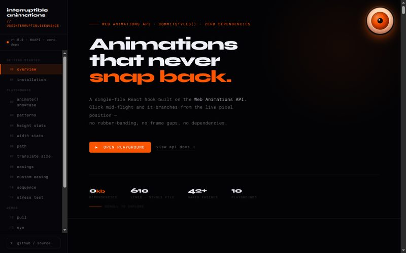
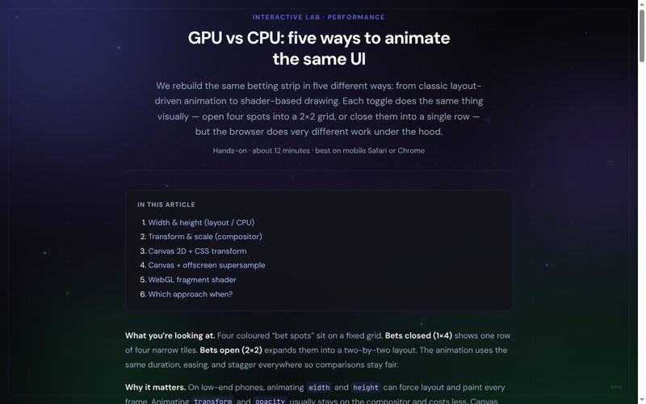
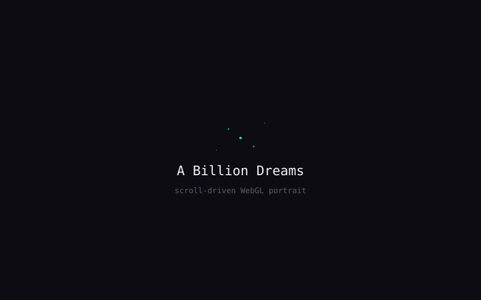
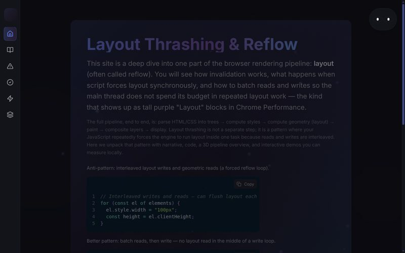
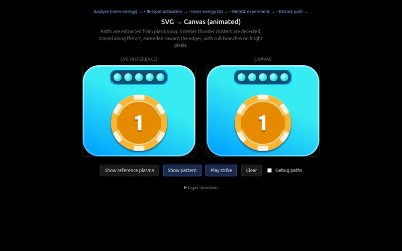
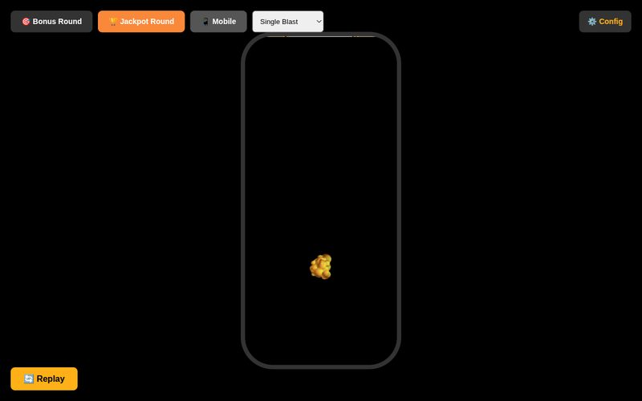

<a href="https://koka-lab.vercel.app">
  <picture>
    <source media="(prefers-color-scheme: dark)" srcset="./assets/hero-dark.svg">
    <source media="(prefers-color-scheme: light)" srcset="./assets/hero-light.svg">
    
  </picture>
</a>

### `0.0ms` ▸ whoami

Senior Frontend Engineer (SDE III). I build interfaces that have to hit **60fps on a mid-range phone**: WebGL scenes, particle systems, scroll-driven stories and real-time UI.
Most of my week is spent inside the Chrome Performance panel, so this page is laid out like one.

### `4.2ms` ▸ rules I build by

```txt
01  animate transform + opacity. everything else is a negotiation.
02  interruptible > pretty. motion must survive a second click.
03  measure first. a flame chart beats an opinion.
04  if it janks on a ₹15k android, it isn't done.
```

### `8.0ms` ▸ experiments

<table>
  <tr>
    <td width="50%" valign="top">
      <a href="https://interruptible-animations.vercel.app"></a>
      <br><b>Interruptible Animations</b><br>
      <sub>A WAAPI React hook. Animations reverse mid-flight instead of snapping back.</sub><br>
      <sub><code>WAAPI</code> <code>React</code> <code>0 deps</code></sub>
    </td>
    <td width="50%" valign="top">
      <a href="https://gpu-vs-cpu-animations.vercel.app"></a>
      <br><b>GPU vs CPU</b><br>
      <sub>One UI animated five ways, from layout to CSS 3D to canvas to a WebGL shader.</sub><br>
      <sub><code>compositor</code> <code>WebGL</code> <code>canvas</code></sub>
    </td>
  </tr>
  <tr>
    <td width="50%" valign="top">
      <a href="https://a-billion-dreams.vercel.app"></a>
      <br><b>A Billion Dreams</b><br>
      <sub>A scroll-driven particle portrait of two cricketing lives.</sub><br>
      <sub><code>WebGL</code> <code>Three.js</code> <code>scroll</code></sub>
    </td>
    <td width="50%" valign="top">
      <a href="https://layout-thrashing-demo.vercel.app"></a>
      <br><b>Layout Thrashing &amp; Reflow</b><br>
      <sub>Forced synchronous layout, read/write batching and what the browser really does.</sub><br>
      <sub><code>rendering</code> <code>reflow</code> <code>DevTools</code></sub>
    </td>
  </tr>
  <tr>
    <td width="50%" valign="top">
      <a href="https://thunder-animation.vercel.app"></a>
      <br><b>Thunder</b><br>
      <sub>Lightning paths extracted from an SVG and re-drawn live on canvas.</sub><br>
      <sub><code>SVG</code> <code>canvas</code> <code>path tracing</code></sub>
    </td>
    <td width="50%" valign="top">
      <a href="https://webgl-particle-bomb.vercel.app"></a>
      <br><b>Particle Bomb</b><br>
      <sub>A GPU-driven particle explosion.</sub><br>
      <sub><code>WebGL</code> <code>particles</code> <code>shaders</code></sub>
    </td>
  </tr>
</table>

<details>
<summary><b>More from the lab</b>: 15 more live experiments</summary>
<br>

**Animation & motion**
[slot machine](https://slot-machine-animation-virid.vercel.app) ·
[poker card deal](https://poker-card-deal.vercel.app) ·
[chip glow](https://chip-glow-animation.vercel.app) ·
[water bubble](https://water-bubble-animation.vercel.app) ·
[animated notes](https://animated-notes.vercel.app) ·
[big bash crash](https://big-bash-crash.vercel.app) ·
[money ball ticket](https://money-ball-ticket-advanced.vercel.app)

**Scroll & image sequences**
[apple-style sequence](https://apple-image-sequence.vercel.app) ·
[cred-style sequence](https://cred-image-sequence.vercel.app) ·
[GLB on scroll](https://glb-scroll-demo.vercel.app)

**Performance & internals**
[web-worker animation](https://web-worker-animation.vercel.app) ·
[react re-render](https://react-rerender-phi.vercel.app) ·
[web fundamentals](https://web-fundamentals-five.vercel.app) ·
[svg → canvas](https://svg-to-canvas.vercel.app) ·
[zustand from scratch](https://zustand-store-scratch.vercel.app)

</details>

### `12.6ms` ▸ now

- 🧪 Building **PerfTrace**, an open-source performance testing tool (Playwright + CDP)
- 🤖 Exploring AI engineering alongside frontend
- 📓 Everything lands first at **[koka-lab.vercel.app](https://koka-lab.vercel.app)**

### `16.6ms` ▸ frame committed ✓

<p>
  <a href="https://koka-lab.vercel.app"></a>
</p>

<sub>React · TypeScript · Next.js · WebGL · Three.js · Canvas · WAAPI · Playwright</sub>
